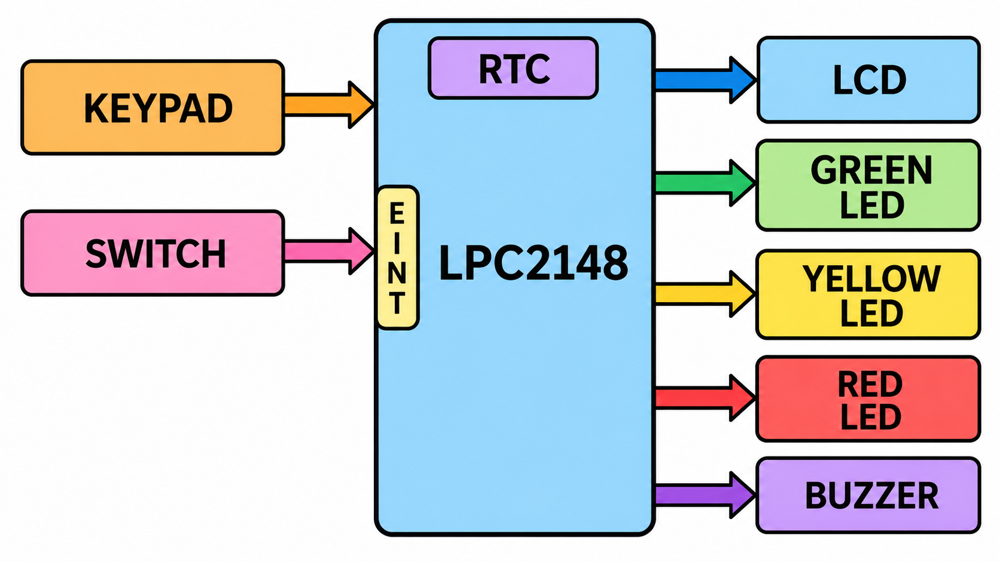

# Smart Railway Platform Announcement System

## 📖 Table of Contents

- 📌 Project Overview
- 🎯 Objectives
- 🖼️ Block Diagram
- 🏗️ System Architecture
- ⚙️ Hardware Requirements
- 💻 Software Requirements
- 📂 Repository Structure
- ✨ Features
- ▶️ Build Instructions
- 📈 Future Enhancements
- 👤 Author

## 📌 Project Overview

The Smart Railway Platform Announcement System is an embedded systems project developed using the **LPC2148 ARM7 microcontroller**.

The system is designed to provide railway platform information using an LCD display, keypad-based user interaction, Real-Time Clock (RTC), LED indications, and buzzer alerts.

The LPC2148 acts as the main controller and manages train-related information through a train database. The LCD displays the relevant information, while the keypad allows user interaction.

This project demonstrates the integration of ARM7 peripherals and embedded C programming to develop a railway platform information and announcement system.

## 🎯 Objectives

- Develop a railway platform information system using LPC2148.
- Display real-time date and time using RTC.
- Provide keypad-based user interaction.
- Display train-related information on LCD.
- Manage train details using a train database.
- Provide visual indications using LEDs.
- Generate buzzer alerts.
- Implement external interrupt handling.
- Develop a modular embedded C application.

## 🖼️ Block Diagram



## 🧩 Block Diagram Explanation

The Smart Railway Platform Announcement System is developed using the LPC2148 ARM7 microcontroller. The LPC2148 acts as the main controller and coordinates all the input and output devices.

### 1. LPC2148 ARM7 Microcontroller
- Acts as the main controller of the entire system.
- Receives input from the keypad and external interrupt switch.
- Processes train details and compares train timings with the current RTC time.
- Controls the LCD, LEDs, and buzzer.

### 2. Keypad
- Used to enter and modify train information.
- Allows the administrator to select menu options.
- Used to update RTC and train details through Admin Mode.

### 3. External Interrupt Switch
- Connected to the EINT0 pin of the LPC2148.
- Generates an external interrupt when the switch is pressed.
- Activates Admin Mode for editing RTC and train information.

### 4. Real-Time Clock (RTC)
- Maintains the current time and date.
- Provides hours, minutes, seconds, date, month, and year.
- The controller uses RTC information to compare current time with train schedules.

### 5. LCD Display
- Displays train number and train name.
- Displays destination and platform number.
- Displays train arrival and departure timings.
- Also displays current date and time.

### 6. LED Indicators
Three LEDs are used to indicate train status:

- 🟡 **Yellow LED:** Indicates that a train is approaching, within 5 minutes of arrival.
- 🟢 **Green LED:** Indicates that the train is present on the platform.
- 🔴 **Red LED:** Indicates train delay or recently modified train information.

### 7. Buzzer
- Provides an audio alert before train arrival.
- Generates three beep signals when the train is 5 minutes away from its scheduled arrival.

### 8. Train Database
- Stores train number, train name, destination, platform number, arrival time, departure time, and delay information.
- Provides train details to the main controller for processing and display.

## 🏗️ System Architecture

| Module | Function |
|---|---|
| Main Module | Controls overall application |
| RTC Driver | Maintains date and time |
| LCD Driver | Displays system information |
| Keypad Driver | Accepts user input |
| External Interrupt | Handles interrupt operations |
| LED Driver | Provides visual indications |
| Buzzer Driver | Provides audio alerts |
| Train Database | Manages train information |
| Menu Module | Handles menu operations |

## ⚙️ Hardware Requirements

| Hardware | Purpose |
|---|---|
| LPC2148 ARM7 Microcontroller | Main controller |
| LCD Display | Displays information |
| Matrix Keypad | User input |
| On-chip RTC | Real-time clock |
| LEDs | Status indication |
| Buzzer | Audio alerts |
| Push Buttons | External interrupt input |

## 💻 Software Requirements
| Software | Purpose|
| ------------ | ----------- |
| Keil µVision | Development / Build |
| Embedded C | Programming |
| Flash Magic | Programming the LPC2148 |

## 📂 Repository Structure

```text
Smart-Railway-Platform-Announcement-System/
│
├── buzzer.c
├── buzzer.h
├── defines.h
├── delay.c
├── delay.h
├── external_interrupt.c
├── external_interrupt.h
├── keypad.c
├── keypad.h
├── keypad_defines.h
├── lcd.c
├── lcd.h
├── lcd_defines.h
├── led.c
├── led.h
├── main.c
├── menu.c
├── menu.h
├── rtc.c
├── rtc.h
├── train_database.c
├── train_database.h
├── train_info.c
├── train_info.h
├── types.h
│
└── README.md
```

## ✨ Features

- LPC2148 ARM7-based embedded application.
- Real-Time Clock integration.
- LCD-based information display.
- Keypad-based user interaction.
- Train database management.
- Menu-driven application.
- LED-based status indication.
- Buzzer-based audio indication.
- External interrupt handling.
- Modular driver implementation.

## ▶️ Build Instructions

1. Install Keil µVision IDE.
2. Create or open the LPC2148 project.
3. Add all required C source and header files.
4. Configure the target microcontroller as LPC2148.
5. Configure clock and peripheral settings.
6. Build the project.
7. Connect the hardware components according to the circuit connections.
8. Generate the HEX file.
9. Flash the HEX file using Flash Magic.
10. Power ON and test the system.

## 📈 Future Enhancements

- 🔊 Implement voice-based train announcements.
- 📡 Add wireless communication for real-time train updates.
- 💾 Store train information in non-volatile memory.
- 📱 Develop a mobile application for passenger notifications.
- 🚆 Integrate real-time train scheduling and tracking.

## 👤 Author

**Bhavya Palloli**

Electronics and Communication Engineering (ECE)

**Technologies:** Embedded C | ARM7 | RTC | LCD | Keypad Interfacing
